<p align="center">
  
</p>

<h1 align="center">Synderz</h1>

<p align="center">An API client and uptime monitor for Android. Think Postman, but it lives on your phone.</p>

<p align="center">
  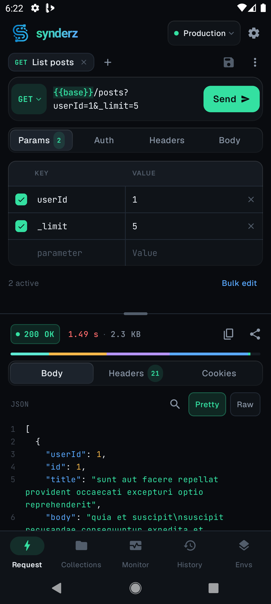
  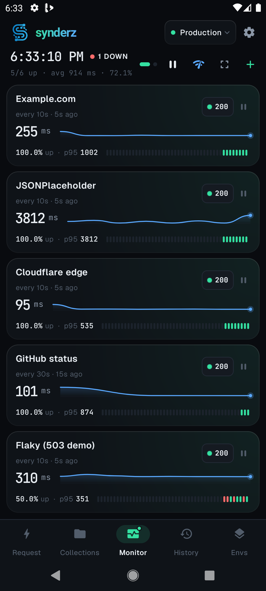
  
</p>

---

I wanted Postman on my phone. There isn't a good open-source one, so I built it. Somewhere along the way it also grew into a small uptime dashboard, which is honestly the part I use most now.

Everything runs on the device. No account, no sync, nothing goes to a server unless you send it there.

> Every screenshot here is from the real app on an emulator, hitting public test APIs (JSONPlaceholder, httpbin, example.com and friends).

## Contents

- [Sending requests](#sending-requests)
- [Reading the response](#reading-the-response)
- [Collections, environments and history](#collections-environments-and-history)
- [cURL in and out](#curl-in-and-out)
- [Monitor](#monitor)
- [Locking it down](#locking-it-down)
- [Landscape](#landscape)
- [Settings](#settings)
- [File formats](#file-formats)
- [Building it](#building-it)
- [Known gaps](#known-gaps)

---

## Sending requests

Any method: GET, POST, PUT, PATCH, DELETE, HEAD, OPTIONS, or type your own (PROPFIND, PURGE, whatever your server speaks).

The URL bar takes on the method's colour. Typing a query string fills the **Params** table as you go, and editing the table rewrites the URL, so the two never drift apart. Hit **Send** or the keyboard's Go key.

| JSON body with a variable | form-data | GraphQL |
|---|---|---|
| 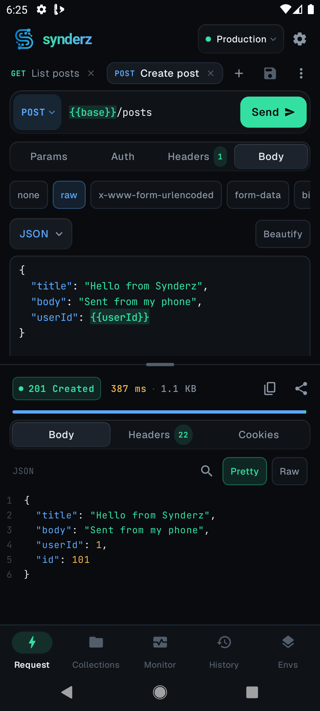 | 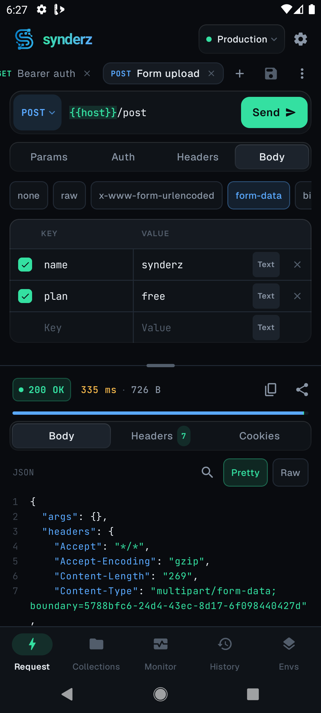 | 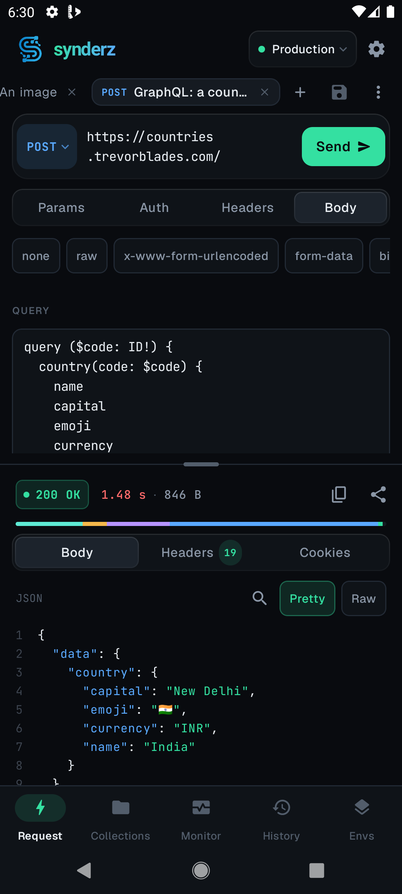 |

**Bodies:**
- **raw**: JSON, Text, XML, HTML or JavaScript, syntax-highlighted while you type. JSON gets a Beautify button.
- **x-www-form-urlencoded**: a key/value table.
- **form-data**: text fields and file uploads. Flip any row between Text and File.
- **binary**: send a file as the whole body.
- **GraphQL**: query plus a variables box, packed into the usual `{"query", "variables"}` JSON.

**Auth:** Bearer token, Basic, or an API key sent as a header or query param. Fields accept `{{variables}}` too.

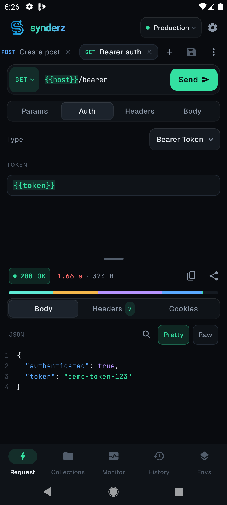

The token above is `{{token}}`, and httpbin echoes back `demo-token-123` from the active environment.

**Headers** use the same key/value table as params and forms, with a checkbox per row to switch it off without deleting it, plus quick-add chips for the usual suspects (`Content-Type`, `Accept`, `Cache-Control`, `User-Agent`). Every table has a **Bulk edit** mode where you just type `key:value` lines.

**Tabs:** keep as many requests open as you like. An amber dot means unsaved changes. Long-press a tab to rename it. The ⋮ menu holds everything else:

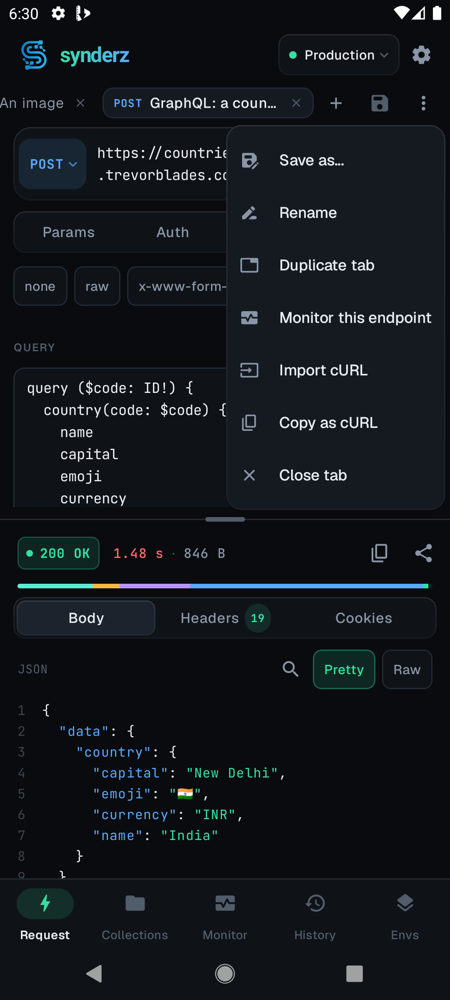

One honest limitation: Android's HTTP stack won't send a body with GET or HEAD. The app tells you rather than silently dropping it.

## Reading the response

Status, time and size up top. Time is coloured: green under 300 ms, amber under a second, red past that.

The thin bar under it is a **timing waterfall**. Tap it and you get the breakdown: DNS, connect, TLS, waiting on the server, download. That's usually how you find out a "slow API" is really a slow handshake.

| Waterfall | Search | Headers |
|---|---|---|
| 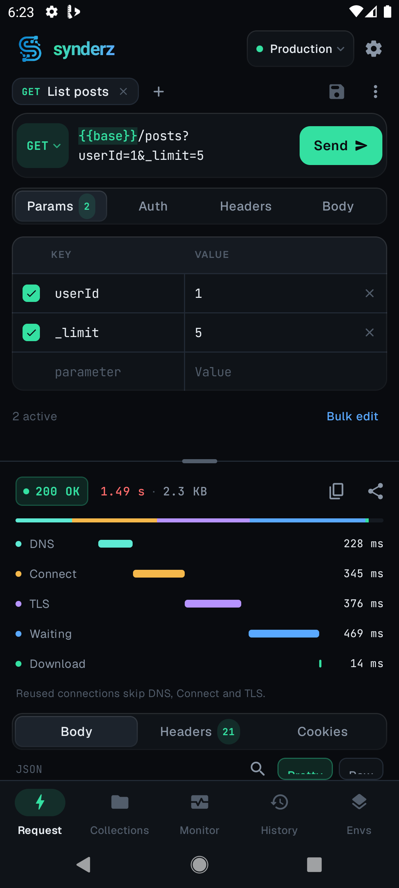 | 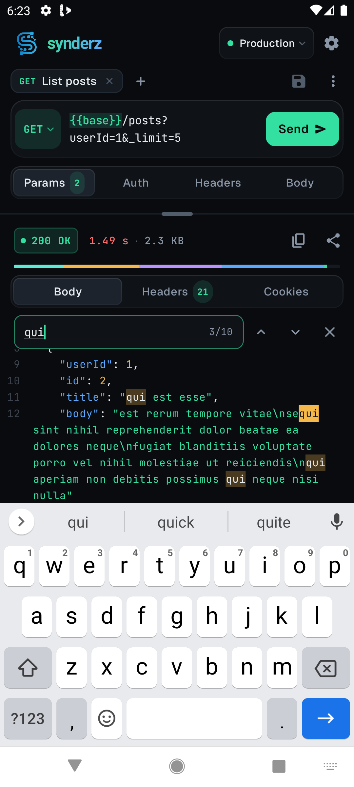 | 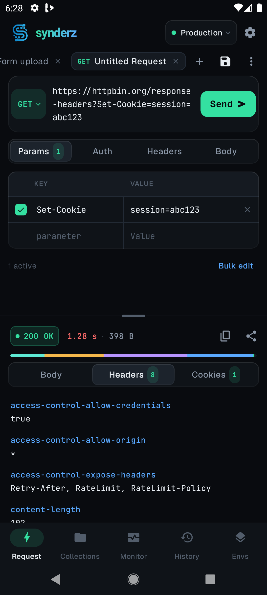 |

- **Pretty / Raw** for JSON, XML and HTML, with line numbers. It stays smooth on multi-megabyte bodies.
- **Search** (the magnifier): highlights every match, steps through them with ↑/↓, and scrolls to each one.
- **Headers** and **Cookies** tabs. Cookies show domain, path, expiry and flags.
- **Images** render inline.
- **Copy** and **Share** the body.

| Cookies | Image preview |
|---|---|
| 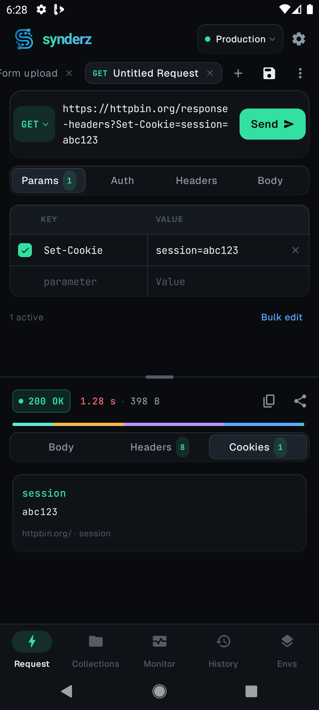 | 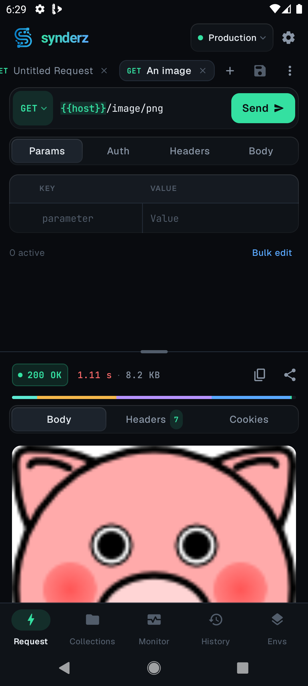 |

Drag the divider between request and response to resize them, or tap it to hand most of the screen to the response.

## Collections, environments and history

| Collections | Collection menu | Environments | History |
|---|---|---|---|
| 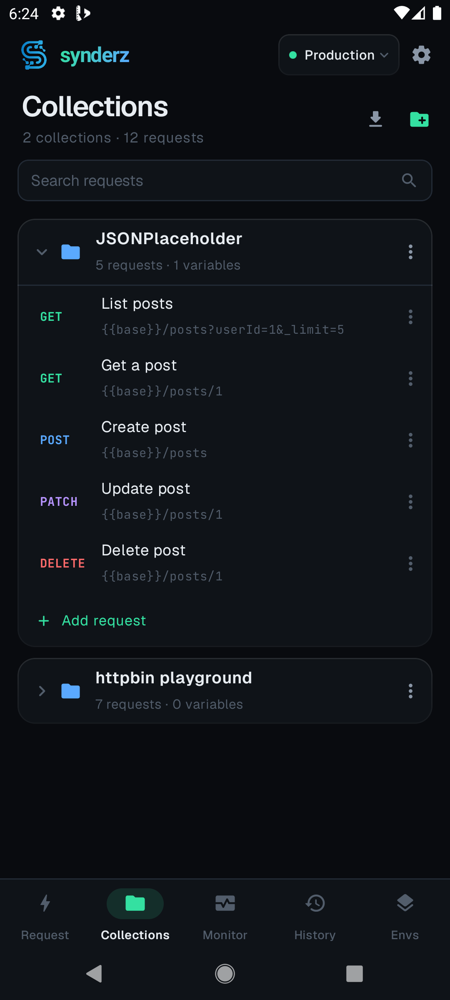 | 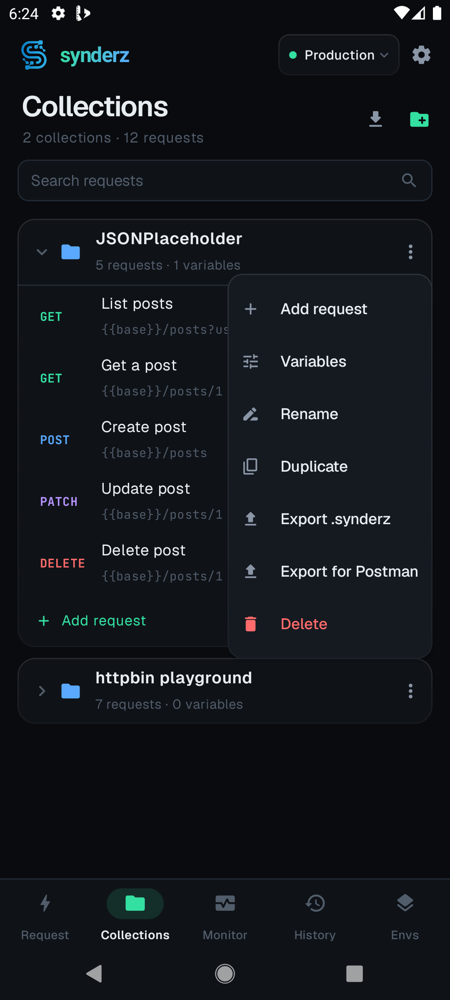 | 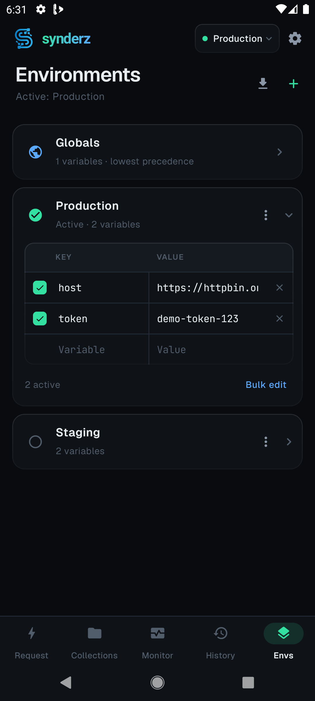 | 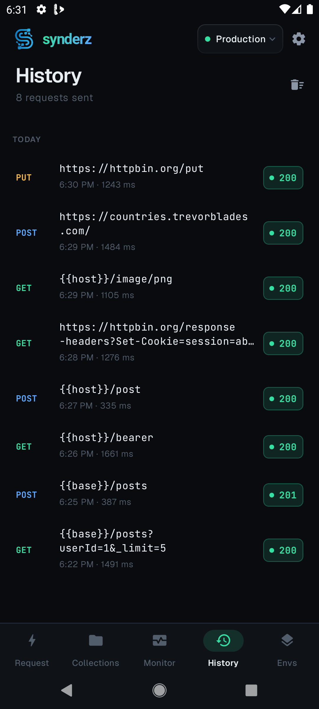 |

**Collections** group saved requests. Search across them, rename, duplicate, delete, and give each collection its own variables. Export as `.synderz` or as a Postman v2.1 collection; import either.

**Environments** are sets of variables you switch between, like Production and Staging. Use `{{name}}` anywhere: URL, params, headers, body, auth. In the editor a variable turns green if it resolves and red if it doesn't, so typos jump out.

When the same name is defined in several places, the active environment wins, then the collection, then **Globals**. There are also built-ins that need no setup: `{{$guid}}`, `{{$timestamp}}`, `{{$isoTimestamp}}`, `{{$randomInt}}`.

Switch environments from the chip in the top bar:

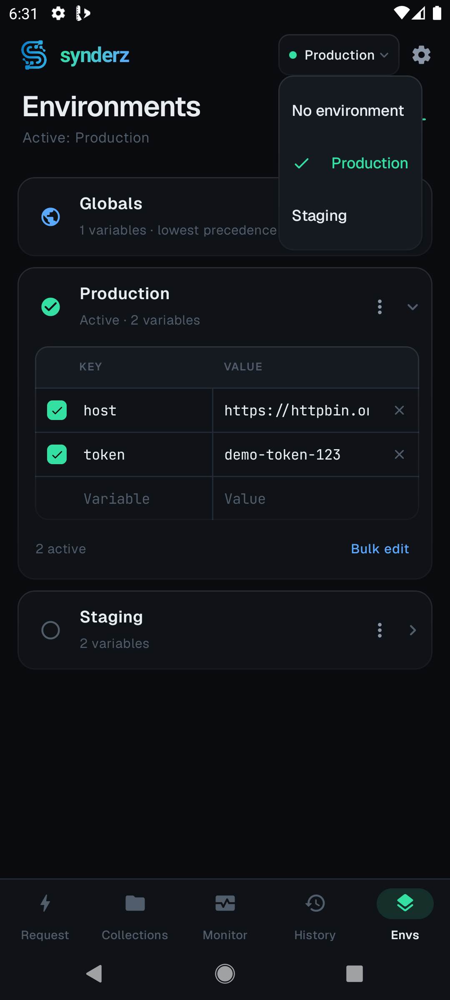

**History** keeps the last 300 requests you sent, grouped by day. Tap one to reopen it in a new tab.

## cURL in and out

Paste a cURL command straight into the URL bar and it turns into a full request: method, headers, body, auth. Chrome's "Copy as cURL" works, including the `$'...'` quoting. There's also an **Import cURL** box in the ⋮ menu, and **Copy as cURL** to go the other way.

| Pasting | Result |
|---|---|
| 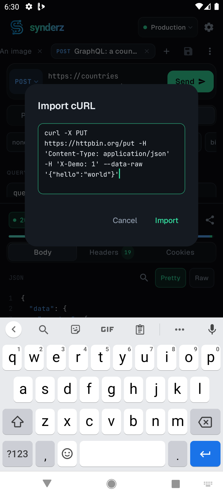 | 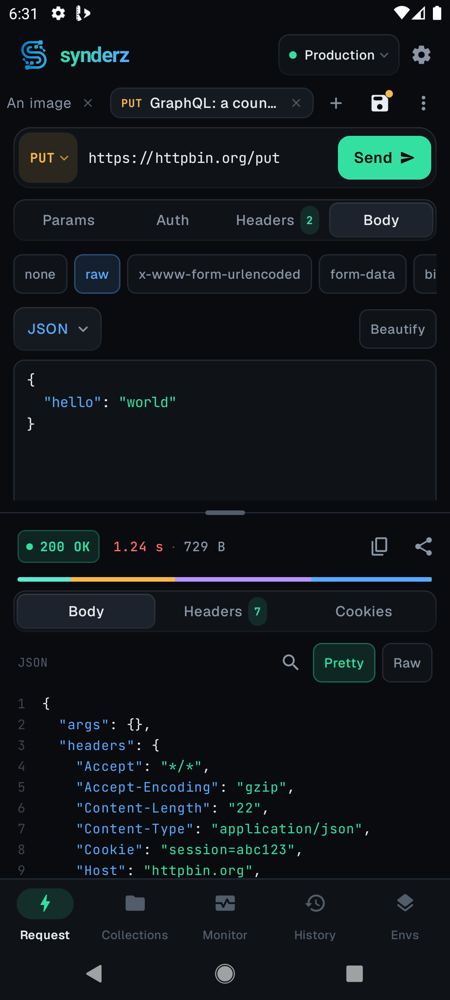 |

## Monitor

This is the bit I leave running on a spare phone.

Add up to 20 endpoints. They show 5 at a time (6 in landscape), so a page is always one glance, and you swipe between pages.

| Dashboard | A site that's down | Adding one |
|---|---|---|
|  | 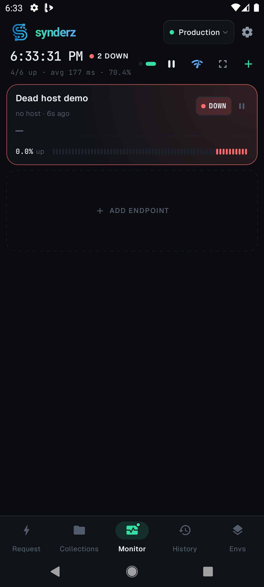 | 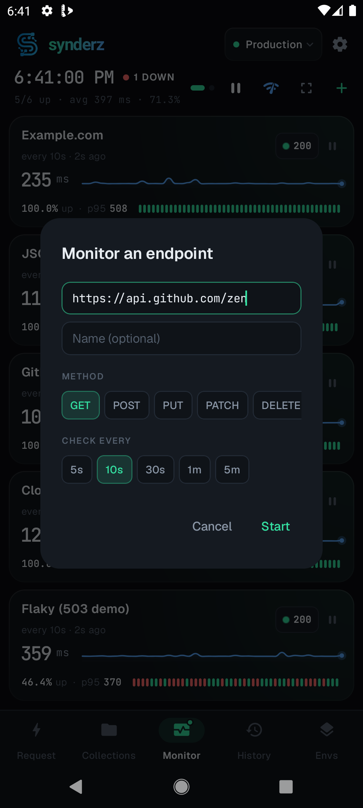 |

Each card shows:
- **The latest response time,** big, with ▲/▼ against its average.
- **A sparkline** of recent checks.
- **A status strip:** one bar per check, green for OK, amber for 4xx, red for 5xx or no response.
- **Uptime and p95.** p95 is the time 95% of checks beat. It tells you how slow things get on a bad but normal moment, which an average hides.
- **A pulsing red border** when it's down, with a short reason like `timeout`, `refused` or `no host`.

The bar at the top is a live clock, how many sites are up, the average, and overall uptime. The phone buzzes when something goes down and again when it comes back. **The screen stays on while anything is being monitored.**

**Reorder** by long-pressing a card and dragging it:

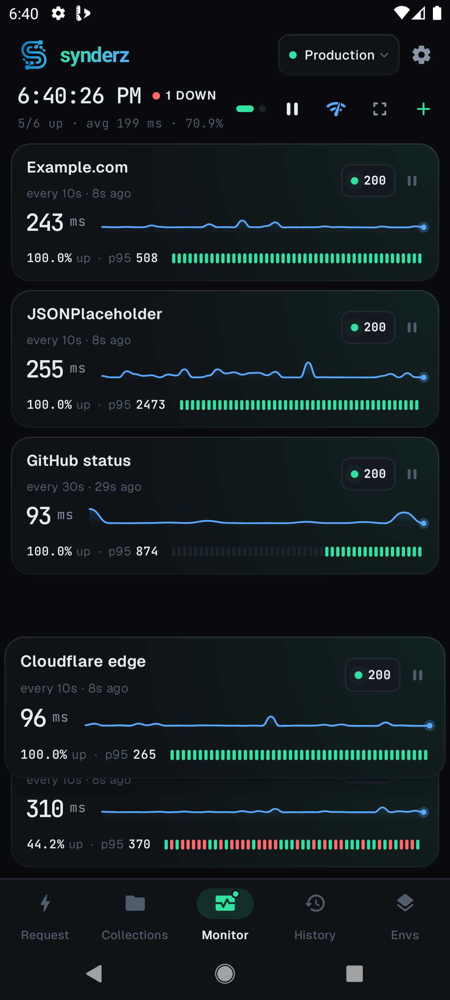

**Check now** (the blue Wi-Fi button) hits every site at once and tries to get past any CDN cache. Cloudflare and most CDNs ignore a client's `no-cache`, so it also adds a one-off `?_synderz=<timestamp>` to change the cache key. The results tell you what each site's cache said (Cloudflare, CloudFront, Fastly, Vercel, `Cache-Status`, `Age`), so you know whether you reached the origin. If an API rejects unknown query params, expect a 4xx from that one.

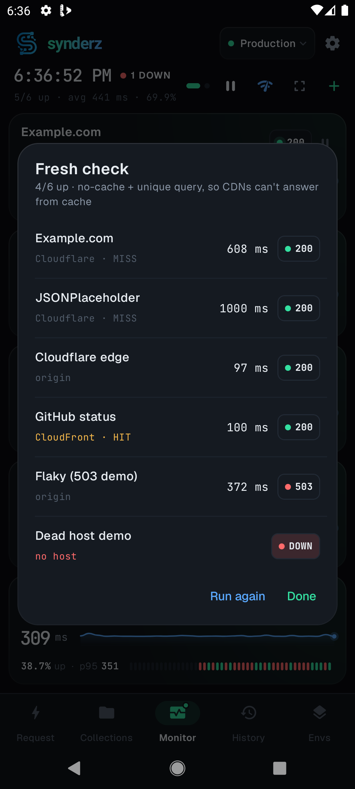

**Tap a card** for the full picture: a big chart you can scrub with your finger, avg/p95/min/max, uptime, check count, the availability strip, the last error, and the check interval (5s to 5m).

| Detail | Lower half |
|---|---|
|  | 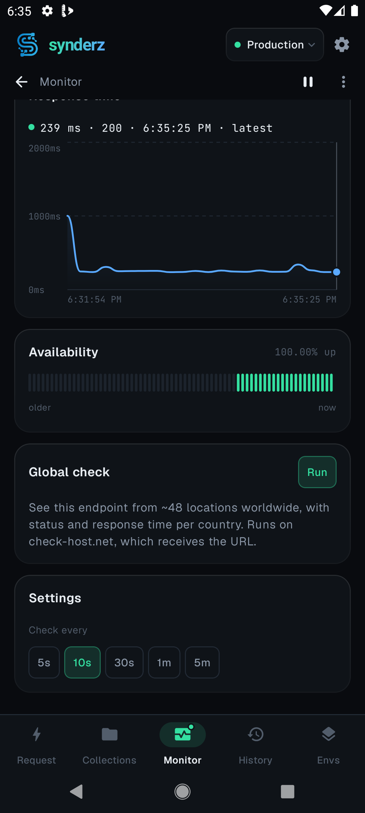 |

**Global check** runs the endpoint through [check-host.net](https://check-host.net) from about 48 locations, with a flag, city and response time for each, problems first. Be aware that this sends the URL to check-host.net, and their free tier rate-limits: run it too often and it'll ask you to wait a few minutes. The screenshot below caught regions still pending, which is what you see while results trickle in.

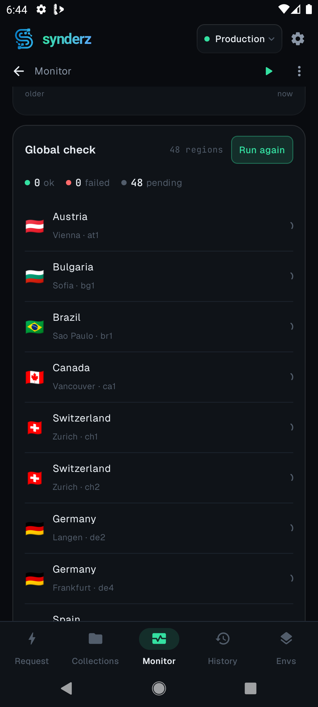

A monitor checks no more often than its interval, and a check can't outlive it, so a slow site can't pile up requests.

## Locking it down

Monitor URLs are hidden behind a PIN. On a card you see `GET •••••••• tap to reveal`. The first time, you set a 4–6 digit PIN. Edit, Open as request, Clear data and Remove all ask for it too.

| PIN pad | Revealed | Wrong PIN |
|---|---|---|
| 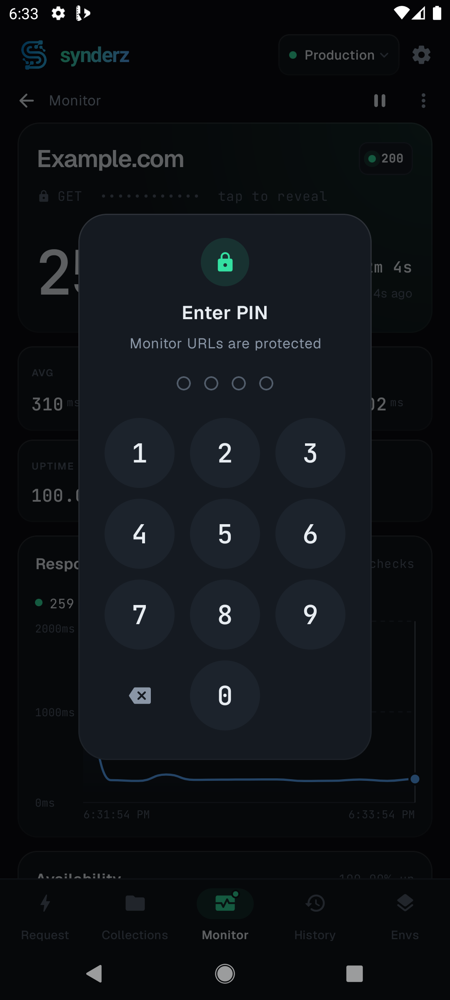 | 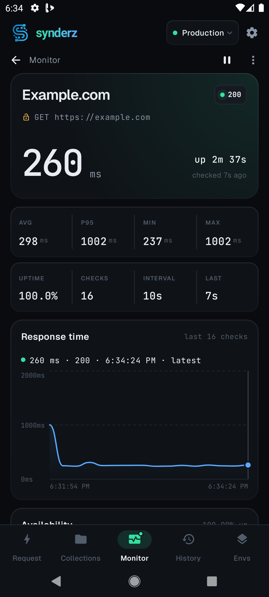 | 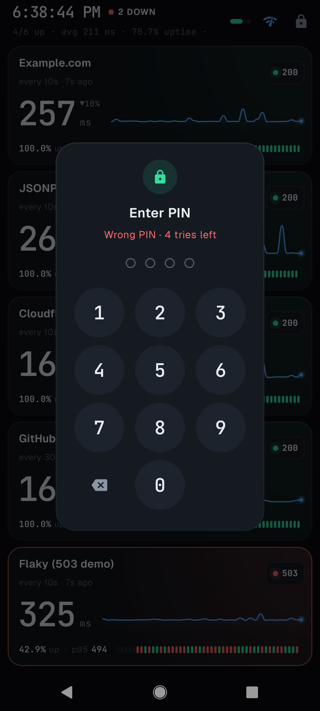 |

**Locked dashboard** (the ⛶ button) is for leaving the phone on a desk where other people can reach it:
- System bars disappear, and Android's app pinning keeps it in the app.
- You can only watch and swipe pages. No pausing, adding, editing or removing.
- Tapping a card opens a read-only detail view.
- Leaving needs the PIN, including the Back button.
- It survives a force-close: relaunch and it comes straight back, locked.

| Locked dashboard | Read-only detail |
|---|---|
| 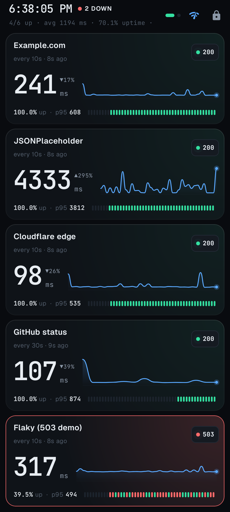 | 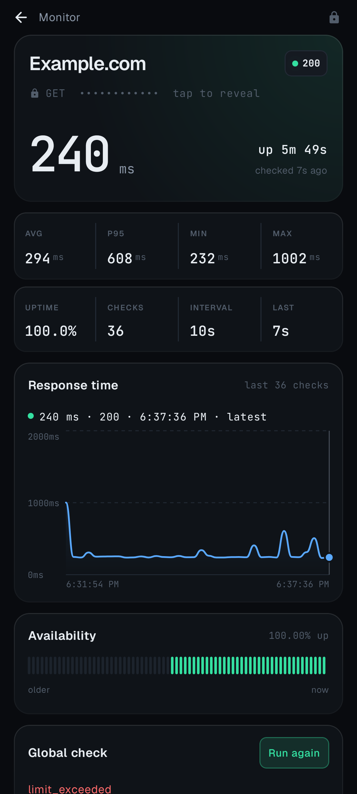 |

On the security side: only a salted SHA-256 hash of the PIN is stored. Five wrong guesses locks the pad for 30s, then 1m, 2m and so on up to an hour. **There is no "forgot PIN".** That's on purpose, so a curious kid can't reset your setup. The way out is Android Settings → Apps → Synderz → Clear storage, which wipes everything.

To stop someone unpinning with Back + Overview, turn on **Ask for PIN before unpinning** in your phone's security settings.

## Landscape

Everything works sideways. Navigation moves to a side rail, request and response sit side by side, the monitor becomes a 3×2 grid, and the detail page splits into two columns.

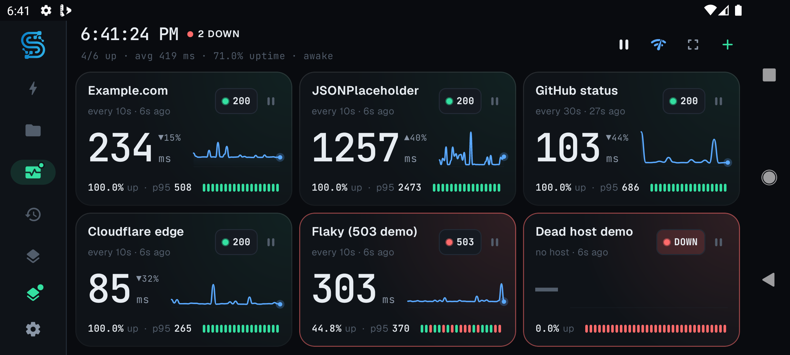

| Request | Monitor detail | PIN pad |
|---|---|---|
| 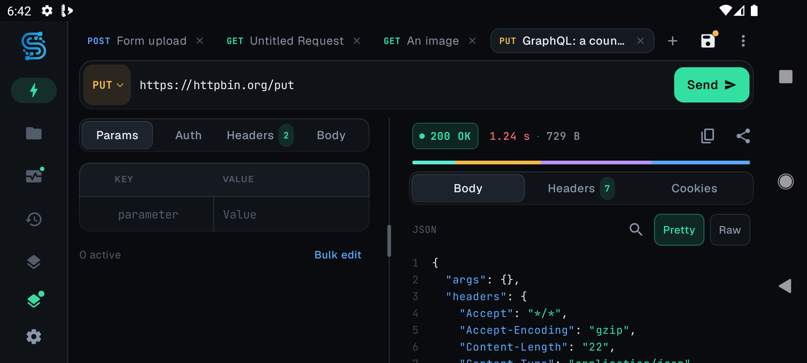 | 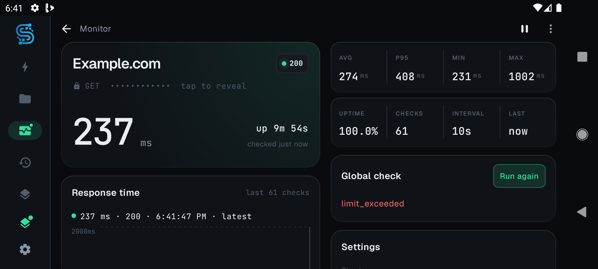 | 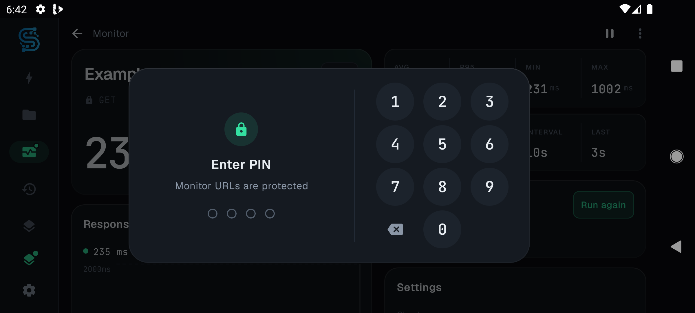 |

## Settings

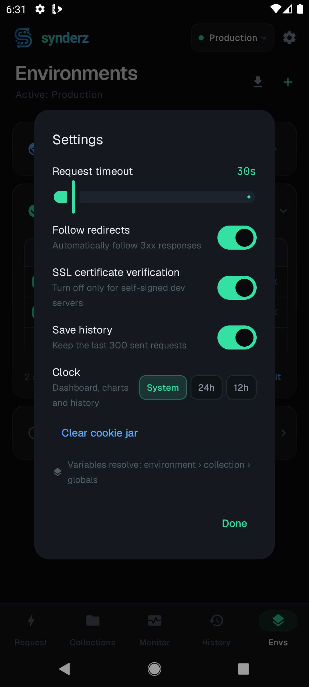

- **Request timeout**, 1–300 seconds.
- **Follow redirects.**
- **SSL certificate verification.** Turn it off only for self-signed dev servers.
- **Save history.**
- **Clock**: System, 24h or 12h. Used by the dashboard, charts and history.
- **Clear cookie jar.** Cookies persist across requests until the app closes, like a browser session.

Plain `http://` works on purpose, so you can hit `localhost` and LAN dev servers.

## File formats

- **`.synderz`** is the app's own format for a collection or environment. It's lossless: everything the app knows about a request round-trips. Plain JSON underneath.
- **Postman v2.1** collections and environments import and export, so you can move work to and from the desktop app. Folders get flattened into names like `Folder / Request`.

## Building it

You'll need Android Studio (or JDK 17+ and the Android SDK).

```sh
git clone <this repo>
cd Synderz
./gradlew assembleDebug        # app/build/outputs/apk/debug/app-debug.apk
./gradlew testDebugUnitTest    # unit tests for the parsing and logic bits
```

Or just open the folder in Android Studio and press Run. Min Android 8.0 (API 26).

Built with Kotlin, Jetpack Compose, OkHttp and kotlinx.serialization. Fonts are Geist and JetBrains Mono.

## Known gaps

Things it doesn't do yet, so you're not surprised:

- **No pre-request or test scripts.** That's the big Postman feature still missing.
- **No WebSocket, gRPC or Socket.IO.**
- **Code snippets are cURL only.**
- **Monitors only run while the app is open.** If Android kills it in the background, checks stop. The screen-stays-on behaviour is there to make the dashboard usable, not to make monitoring bulletproof.
- **Monitor data points live in memory,** so a restart or update starts the graphs over. The monitors themselves are saved.
- **App data isn't encrypted at rest,** and Android backups are on. If you keep real tokens in here, keep that in mind.

## License

MIT. See [LICENSE](LICENSE).
